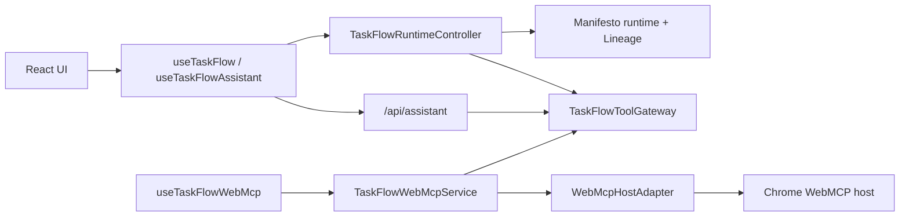

# TaskFlow Architecture

TaskFlow uses Manifesto as the application state engine. MEL defines the domain, a client-owned runtime owns state in the browser, Lineage records meaningful continuity, and both the in-app assistant and WebMCP consume the same runtime contract.

## Overview

TaskFlow is organized around one rule: the UI does not own a parallel state model. It reads projected runtime state and writes through runtime-backed actions.

Primary seams:

- [`taskflow.mel`](../src/domain/taskflow.mel)
- [`TaskFlowRuntimeController`](../src/lib/taskflow-runtime-controller.ts)
- [`TaskFlowToolGateway`](../src/lib/taskflow-tool-gateway.ts)
- [`useTaskFlowAssistant`](../src/hooks/useTaskFlowAssistant.ts)
- [`useTaskFlowWebMcp`](../src/hooks/useTaskFlowWebMcp.ts)

## Core Integration

TaskFlow integrates Manifesto like this:

- MEL defines state, actions, and computed projections
- the app imports the `.mel` file through the real Next.js graph
- the browser activates the Manifesto + Lineage runtime
- the controller turns runtime snapshots into the app-facing contract
- UI actions and agent actions both resolve through runtime intents

This keeps the app on one state model:

- React renders snapshot-derived state
- assistant tools mutate the same runtime
- WebMCP exposes the same capability surface to a browser host

## Runtime Ownership

[`TaskFlowRuntimeController`](../src/lib/taskflow-runtime-controller.ts) is the source of truth for live app state. It owns:

- Manifesto runtime activation
- Lineage store and history metadata
- runtime-derived view state
- ephemeral UI session state such as dialogs and semantic hover

The controller exposes that state through [`useTaskFlow`](../src/hooks/useTaskFlow.ts). The React tree does not talk to Manifesto directly.

The key boundary is:

- controller owns state
- gateway exposes capabilities
- transports consume the gateway

## High-Level Flow

## Assistant Path

The in-app assistant is server-orchestrated but client-executed.

- the client builds `TaskFlowAgentContext`
- the server route builds the prompt and registers tool schemas
- tool calls are streamed back to the client
- the client executes those tool calls against the local runtime

This keeps the model off the critical path of state ownership. The model can reason over context, but the product runtime remains local and authoritative.

## WebMCP Path

WebMCP is an additional consumer of the same runtime contract, not a second app state model.

Internal split:

- [`TaskFlowToolGateway`](../src/lib/taskflow-tool-gateway.ts): shared read/write seam
- [`taskflow-webmcp-service.ts`](../src/lib/taskflow-webmcp-service.ts): lifecycle, retry, debug state
- [`webmcp-host-adapter.ts`](../src/lib/webmcp-host-adapter.ts): `navigator.modelContext`
- [`taskflow-webmcp-catalog.ts`](../src/lib/taskflow-webmcp-catalog.ts): fixed host-facing tool catalog

The WebMCP path:

- feature-detects `navigator.modelContext`
- registers tools through `registerTool(..., { signal })`
- keeps registrations long-lived
- reads fresh state through `get_taskflow_context`
- never moves state ownership off the client runtime

For the Chrome-specific framing, see [CHROME-WEBMCP.md](./CHROME-WEBMCP.md).

## Lineage and Clock

Lineage records one world per meaningful intent. TaskFlow uses it for:

- visible history
- branch and visible world context
- causal graph construction for the assistant
- continuity across manual and agent-driven actions

TaskFlow also uses an intent-stamped host clock:

- each committed intent gets a fresh clock stamp
- MEL stores the latest `clock`
- date-derived reads stay consistent across UI, assistant, and lineage

There is no ticking background sync.

## Constraints

- The client runtime is the source of truth.
- The server never owns canonical task state.
- WebMCP is optional and dormant when `navigator.modelContext` is unavailable.
- Hover grounding is local UI context, not lineaged domain state.
- Branch switching and world restore are not exposed through assistant or WebMCP.
- `pnpm dev` and `pnpm build` use webpack so `.mel` imports stay on the live app path.
