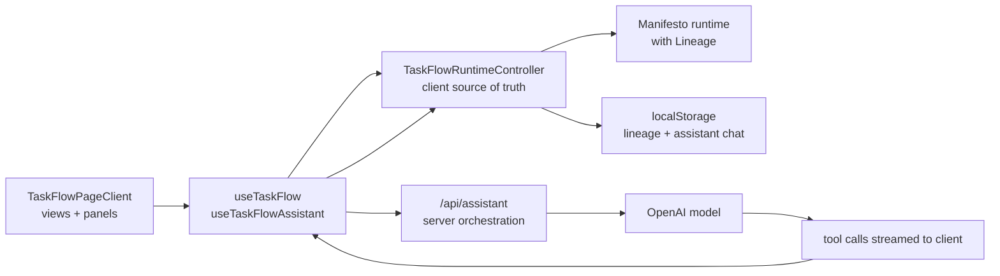

# TaskFlow Architecture

This document describes the current TaskFlow architecture as implemented in the repo today.

## System Overview

TaskFlow uses a client-owned Manifesto runtime as its source of truth. The browser activates the domain, applies lineage commits, derives the view model, and persists local state. The server route exists only to stream model responses and tool calls for the assistant. MEL defines the domain state, actions, and computed projections.

Primary implementation seams:

- [`TaskFlowPageClient`](../src/components/taskflow/TaskFlowPageClient.tsx)
- [`useTaskFlow`](../src/hooks/useTaskFlow.ts)
- [`useTaskFlowAssistant`](../src/hooks/useTaskFlowAssistant.ts)
- [`TaskFlowRuntimeController`](../src/lib/taskflow-runtime-controller.ts)
- [`/api/assistant`](../src/app/api/assistant/route.ts)
- [`taskflow.mel`](../src/domain/taskflow.mel)

## High-Level Diagram

## Runtime and State Ownership

[`TaskFlowRuntimeController`](../src/lib/taskflow-runtime-controller.ts) owns the live application state. It activates the runtime, subscribes to snapshot changes, decorates the runtime snapshot with lineage/history metadata, and merges in ephemeral UI session state.

The controller exposes a single view model consumed through [`useTaskFlow`](../src/hooks/useTaskFlow.ts):

- runtime-backed task state and computed slices
- lineage-derived history and branch visibility
- ephemeral UI session state such as dialog visibility and hovered targets
- action methods used by the page and panels

The page itself does not talk to Manifesto directly. [`TaskFlowPageClient`](../src/components/taskflow/TaskFlowPageClient.tsx) renders views, detail panels, history, dialogs, and the assistant against the controller-owned contract.

## MEL, Codegen, and Build Path

The domain is authored in [`src/domain/taskflow.mel`](../src/domain/taskflow.mel). It defines:

- task state
- computed projections for active/deleted/status-grouped tasks
- lineage-committed UI actions such as selection, view changes, and assistant visibility
- clock-stamped actions for CRUD and status transitions

The live Next.js module graph imports [`src/domain/taskflow.schema.ts`](../src/domain/taskflow.schema.ts) from [`src/app/layout.tsx`](../src/app/layout.tsx). This keeps the `.mel` file on the real app path so webpack codegen can emit [`src/domain/taskflow.domain.ts`](../src/domain/taskflow.domain.ts) during development and build.

Relevant build seams:

- [`next.config.ts`](../next.config.ts) wires the Manifesto compiler/codegen webpack plugin.
- [`manifesto.config.ts`](../manifesto.config.ts) keeps repo-level tooling configuration aligned with the current setup.
- `pnpm dev` and `pnpm build` both run with webpack to preserve `.mel` processing.

## Lineage Model

TaskFlow commits one lineage world per meaningful intent. That includes domain mutations and selected UI actions that are intentionally tracked as part of user flow.

Lineage responsibilities:

- runtime world history for each committed intent
- human-readable history summaries recorded alongside worlds
- active branch and visible head bookkeeping
- causal graph construction for assistant context
- history panel rendering in [`LineagePanel`](../src/components/history/LineagePanel.tsx)

The assistant receives both `recentHistory` and a causal graph so it can reason about how the current snapshot was reached, not just what the current snapshot contains.

## Clock Model

TaskFlow uses an intent-stamped host clock. There is no ticking background sync.

- each committed intent gets a fresh host-produced clock stamp
- the MEL state stores the latest `clock`
- computed values such as `dueTodayTasks` and `overdueTasks` are derived from that clock
- UI date presets and assistant context read the same clock-aligned snapshot data

This keeps date semantics consistent across the UI, the assistant, and lineage without generating timer-driven noise in history.

## Assistant Architecture

[`useTaskFlowAssistant`](../src/hooks/useTaskFlowAssistant.ts) owns the assistant client flow. It uses `useChat` and sends the current [`TaskFlowAgentContext`](../src/types/taskflow-assistant.ts) with each request.

The server route at [`src/app/api/assistant/route.ts`](../src/app/api/assistant/route.ts):

- validates UI messages and agent context
- builds the system prompt from MEL, snapshot data, causal graph, and hovered target context
- exposes tool schemas only
- streams model output and tool calls back to the client

Actual task execution happens on the client:

- the assistant hook receives tool calls
- [`TaskFlowRuntimeController`](../src/lib/taskflow-runtime-controller.ts) executes them against the local runtime
- tool results are fed back into the chat loop
- the assistant is capped to a short multi-step loop

Special cases:

- `delete_task` requires explicit client confirmation before the commit is applied
- unresolved tool calls are dropped before sending the next message so stale tool state does not poison the chat loop

## Hover Grounding

Semantic hover is an assistant grounding aid, not part of the lineaged domain state.

- semantic targets are registered from task cards, header actions, and lineage rows
- the last meaningful hover is stored in ephemeral UI state
- that hover state is captured into assistant context at turn boundaries
- the assistant can inspect or activate hovered targets through dedicated tools

Current hover target kinds:

- task cards
- header actions (`create-task`, `date-filter`, `history`)
- lineage entries

Hovered lineage entries are read-only. They can be inspected or used to drive lineage search, but they are not directly activated.

## Persistence Model

TaskFlow persists browser-local state in [`taskflow-runtime-persistence.ts`](../src/lib/taskflow-runtime-persistence.ts):

- lineage runtime store snapshot
- lineage history metadata
- assistant UI messages

Persistence rules:

- lineage state is versioned and schema-hash checked
- schema mismatch invalidates stored lineage state and reseeds the runtime
- assistant chat remains local to the same browser profile
- there is no remote database, session backend, or collaborative sync layer

## Known Constraints

- The workspace is local-only.
- The server never becomes the canonical task runtime.
- Assistant tools operate against the current client runtime contract only.
- World restore, branch switching, and similar lineage control flows are not exposed to the assistant.
- `pnpm build` currently emits a non-blocking `baseline-browser-mapping` outdated-data warning.
