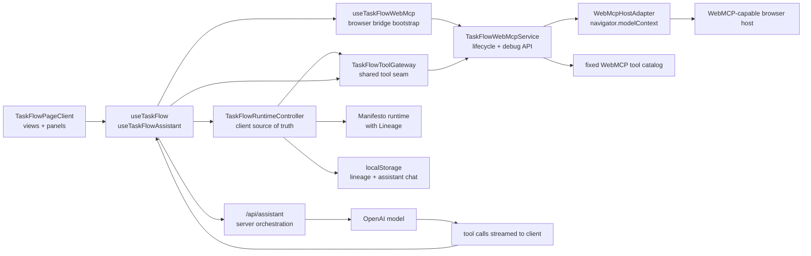

# TaskFlow Architecture

This document describes the current TaskFlow architecture as implemented in the repo today, with a Manifesto-first framing. TaskFlow is intended to serve as a showcase of how Manifesto can sit at the center of an interactive product UI rather than being treated as a backend-only or toy domain layer.

## Showcase Goal

TaskFlow is not meant to demonstrate a generic kanban app architecture. It is meant to demonstrate a specific integration direction:

- Manifesto owns the domain state and transition semantics
- the UI renders directly from projected snapshot state
- Lineage upgrades state transitions into visible continuity and history
- assistant actions are routed through the same runtime contract as manual UI actions
- WebMCP host calls are routed through the same runtime contract as manual UI actions
- ephemeral UI context, such as semantic hover, is composed around the runtime instead of replacing it

The important architectural question in this repo is therefore not just "how does the UI work?" but "how does a modern UI stay integrated with a Manifesto runtime without forking its own state model?"

## System Overview

TaskFlow uses a client-owned Manifesto runtime as its source of truth. The browser activates the domain, applies lineage commits, derives the view model, persists local state, and now also exposes a WebMCP tool surface over that same runtime. The server route exists only to stream model responses and tool calls for the in-app assistant. MEL defines the domain state, actions, and computed projections.

Primary implementation seams:

- [`TaskFlowPageClient`](../src/components/taskflow/TaskFlowPageClient.tsx)
- [`useTaskFlow`](../src/hooks/useTaskFlow.ts)
- [`useTaskFlowAssistant`](../src/hooks/useTaskFlowAssistant.ts)
- [`useTaskFlowWebMcp`](../src/hooks/useTaskFlowWebMcp.ts)
- [`TaskFlowRuntimeController`](../src/lib/taskflow-runtime-controller.ts)
- [`TaskFlowToolGateway`](../src/lib/taskflow-tool-gateway.ts)
- [`taskflow-webmcp-service.ts`](../src/lib/taskflow-webmcp-service.ts)
- [`webmcp-host-adapter.ts`](../src/lib/webmcp-host-adapter.ts)
- [`/api/assistant`](../src/app/api/assistant/route.ts)
- [`taskflow.mel`](../src/domain/taskflow.mel)

## Manifesto Integration Direction

TaskFlow demonstrates the following usage pattern for Manifesto in a product UI:

- author the domain in MEL
- import the `.mel` source through the real application module graph
- activate the runtime where the application actually owns state
- treat `getSnapshot()` as the app-facing read model
- route both manual UI actions and assistant tool execution through runtime intents
- let Lineage record continuity for meaningful actions instead of inventing a separate app history model

In other words, the UI is not a parallel state machine with Manifesto bolted on the side. The UI is a consumer of Manifesto's projected state and a producer of Manifesto intents.

The WebMCP path extends that same direction. It does not create a second browser-agent state model. It publishes the already-existing runtime contract to a browser host.

## High-Level Diagram

## Runtime and State Ownership

[`TaskFlowRuntimeController`](../src/lib/taskflow-runtime-controller.ts) owns the live application state. It activates the runtime, subscribes to snapshot changes, decorates the runtime snapshot with lineage/history metadata, and merges in ephemeral UI session state.

The controller exposes a single view model consumed through [`useTaskFlow`](../src/hooks/useTaskFlow.ts):

- runtime-backed task state and computed slices
- lineage-derived history and branch visibility
- ephemeral UI session state such as dialog visibility and hovered targets
- action methods used by the page and panels

The page itself does not talk to Manifesto directly. [`TaskFlowPageClient`](../src/components/taskflow/TaskFlowPageClient.tsx) renders views, detail panels, history, dialogs, and the assistant against the controller-owned contract.

This controller layer is the main UI integration seam. It keeps the React tree from needing to know about runtime activation details while still ensuring that the runtime remains the underlying source of truth.

## WebMCP Architecture

The WebMCP path is now split into explicit layers instead of one all-in-one bridge file.

- [`TaskFlowToolGateway`](../src/lib/taskflow-tool-gateway.ts)
  owns the shared read/write seam for assistant tools and WebMCP tools
- [`taskflow-webmcp-service.ts`](../src/lib/taskflow-webmcp-service.ts)
  owns startup, retry, registration ownership, and the browser debug API
- [`webmcp-host-adapter.ts`](../src/lib/webmcp-host-adapter.ts)
  isolates `navigator.modelContext`, `registerTool(..., { signal })`, and compatibility cleanup
- [`taskflow-webmcp-catalog.ts`](../src/lib/taskflow-webmcp-catalog.ts)
  defines the fixed host-facing tool catalog and nothing else

[`useTaskFlowWebMcp`](../src/hooks/useTaskFlowWebMcp.ts) is intentionally thin. It bootstraps the service on mount and retries startup after later user activation or focus/visibility regain.

The bridge keeps the internal architecture unchanged:

- ChatUI assistant remains app-local and server-orchestrated
- WebMCP remains browser-local and host-facing
- both consume the same controller and therefore the same Manifesto snapshot

Current WebMCP surface:

- `get_taskflow_context`
- `create_task`
- `update_task`
- `move_task`
- `delete_task`
- `restore_task`
- `select_task`
- `search_lineage`
- `task_brief_list`
- `inspect_hovered_target`
- `activate_hovered_target`

`delete_task` is intentionally different from the in-app assistant path: the first call returns a structured confirmation requirement, and only a second call with `confirmed: true` performs the mutation.

The important ownership rule is that WebMCP registrations are long-lived and self-owned by the host adapter. Runtime state changes do not trigger tool re-registration. Hosts fetch fresh runtime state through `get_taskflow_context`.

## MEL, Codegen, and Build Path

The domain is authored in [`src/domain/taskflow.mel`](../src/domain/taskflow.mel). It defines:

- task state
- computed projections for active/deleted/status-grouped tasks
- lineage-committed UI actions such as selection, view changes, and assistant visibility
- clock-stamped actions for CRUD and status transitions

The live Next.js module graph imports [`src/domain/taskflow.schema.ts`](../src/domain/taskflow.schema.ts) from [`src/app/layout.tsx`](../src/app/layout.tsx). This keeps the `.mel` file on the real app path so webpack codegen can emit [`src/domain/taskflow.domain.ts`](../src/domain/taskflow.domain.ts) during development and build.

Relevant build seams:

- [`next.config.ts`](../next.config.ts) wires the Manifesto compiler/codegen webpack plugin.
- [`manifesto.config.ts`](../manifesto.config.ts) keeps repo-level tooling configuration aligned with the current setup.
- `pnpm dev` and `pnpm build` both run with webpack to preserve `.mel` processing.

This path matters for the showcase because it demonstrates that MEL is part of the real app graph, not a disconnected artifact or a documentation-only sample.

## Lineage Model

TaskFlow commits one lineage world per meaningful intent. That includes domain mutations and selected UI actions that are intentionally tracked as part of user flow.

Lineage responsibilities:

- runtime world history for each committed intent
- human-readable history summaries recorded alongside worlds
- active branch and visible head bookkeeping
- causal graph construction for assistant context
- history panel rendering in [`LineagePanel`](../src/components/history/LineagePanel.tsx)

The assistant receives both `recentHistory` and a causal graph so it can reason about how the current snapshot was reached, not just what the current snapshot contains.

This is part of the Manifesto showcase value: once execution is committed through a lineage runtime, UI history and agent history no longer need to be invented as separate product systems.

## Clock Model

TaskFlow uses an intent-stamped host clock. There is no ticking background sync.

- each committed intent gets a fresh host-produced clock stamp
- the MEL state stores the latest `clock`
- computed values such as `dueTodayTasks` and `overdueTasks` are derived from that clock
- UI date presets and assistant context read the same clock-aligned snapshot data

This keeps date semantics consistent across the UI, the assistant, and lineage without generating timer-driven noise in history.

## Assistant Architecture

[`useTaskFlowAssistant`](../src/hooks/useTaskFlowAssistant.ts) owns the assistant client flow. It uses `useChat` and sends the current [`TaskFlowAgentContext`](../src/types/taskflow-assistant.ts) with each request.

The server route at [`src/app/api/assistant/route.ts`](../src/app/api/assistant/route.ts):

- validates UI messages and agent context
- builds the system prompt from MEL, snapshot data, causal graph, and hovered target context
- exposes tool schemas only
- streams model output and tool calls back to the client

Actual task execution happens on the client:

- the assistant hook receives tool calls
- [`TaskFlowRuntimeController`](../src/lib/taskflow-runtime-controller.ts) executes them against the local runtime
- tool results are fed back into the chat loop
- the assistant is capped to a short multi-step loop

This is intentional. The showcase is demonstrating that LLM orchestration does not need to own the app state. The model can stay on the server while the product runtime remains local, typed, and grounded in the same Manifesto snapshot the UI is reading.

This split is also what makes the WebMCP path clean: the server path is optional for browser-hosted agents because the browser can expose runtime-backed tools directly from the page.

For the Chrome-facing showcase framing and verification flow, see [CHROME-WEBMCP.md](./CHROME-WEBMCP.md).

Special cases:

- `delete_task` requires explicit client confirmation before the commit is applied
- unresolved tool calls are dropped before sending the next message so stale tool state does not poison the chat loop

## Hover Grounding

Semantic hover is an assistant grounding aid, not part of the lineaged domain state.

- semantic targets are registered from task cards, header actions, and lineage rows
- the last meaningful hover is stored in ephemeral UI state
- that hover state is captured into assistant context at turn boundaries
- the assistant can inspect or activate hovered targets through dedicated tools

Current hover target kinds:

- task cards
- header actions (`create-task`, `date-filter`, `history`)
- lineage entries

Hovered lineage entries are read-only. They can be inspected or used to drive lineage search, but they are not directly activated.

This split is also part of the integration story: UI semantics that matter for interpretation can be composed around Manifesto without polluting the core runtime with raw pointer noise.

## Persistence Model

TaskFlow persists browser-local state in [`taskflow-runtime-persistence.ts`](../src/lib/taskflow-runtime-persistence.ts):

- lineage runtime store snapshot
- lineage history metadata
- assistant UI messages

Persistence rules:

- lineage state is versioned and schema-hash checked
- schema mismatch invalidates stored lineage state and reseeds the runtime
- assistant chat remains local to the same browser profile
- there is no remote database, session backend, or collaborative sync layer

## Known Constraints

- The workspace is local-only.
- The server never becomes the canonical task runtime.
- Assistant tools operate against the current client runtime contract only.
- WebMCP only activates when the browser exposes `navigator.modelContext`.
- World restore, branch switching, and similar lineage control flows are not exposed to the assistant.
- `pnpm build` currently emits a non-blocking `baseline-browser-mapping` outdated-data warning.

## Why This Matters

For Manifesto, the point of this architecture is not just that TaskFlow works. The point is that the repo now shows a coherent UI integration model:

- MEL for domain definition
- activated runtime as application state
- Lineage as continuity and explainability
- React as a snapshot renderer
- LLMs as tool users over the same runtime contract
- WebMCP as a browser-native host integration layer over the same runtime contract

That is the primary architectural story this showcase is intended to tell.
